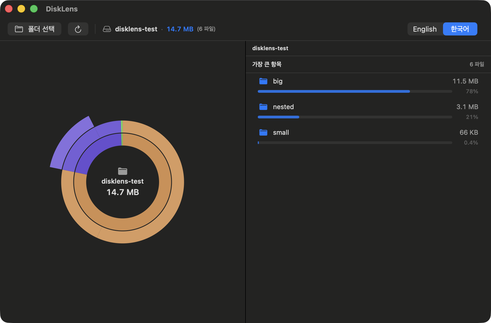

# DiskLens

A native macOS disk-usage analyzer. Point it at a folder and it maps what's
eating your space as an interactive **sunburst** chart — click a slice to drill
in, and move space hogs to the Trash from the side panel.



## Features

- **Sunburst visualization** — folder hierarchy as concentric rings, each slice
  sized by its share of on-disk usage. Hover for details, click to drill in,
  click the center hole (or the breadcrumb) to go back up.
- **Accurate sizing** — on-disk allocated size, hidden files included (`.git`,
  caches, dotfiles), symlinks never followed. Scans stop at volume boundaries,
  so a snapshot remount like `/System/Volumes/Update/mnt1` isn't counted as a
  second copy of `/`; hardlinked files are counted once; and system volumes
  (Preboot, VM, Update) are reported at their real size instead of walked. The
  disk's actual usage is shown next to the scanned total.
- **Honest permission reporting** — unreadable folders are split into the ones
  Full Disk Access can unlock and the root-owned ones no permission will, and
  you can list exactly which were skipped.
- **Contents panel** — the focused folder's children, largest first, with
  proportion bars and percentages.
- **Move to Trash** — recoverable cleanup (never a hard delete), with a
  confirmation step. Also "Reveal in Finder".
- **Fast, cancellable scans** off the main thread, with live progress.
- **Korean / English** UI, light & dark mode.

## Build & run

Requires macOS 14+ and the Swift toolchain (Xcode command-line tools).

```bash
./build.sh          # release build → DiskLens.app
open DiskLens.app
```

`./build.sh debug` builds a debug configuration. The script assembles the
`.app` bundle and builds the icon (if `icons/appicon-1024.png` exists).

### Signing

`build.sh` signs with a local `DiskLens Self-Signed` identity when present, so
the app's designated requirement is stable across rebuilds and a granted **Full
Disk Access** persists. Without that identity it falls back to ad-hoc signing.
Create the identity once (self-signed code-signing cert named `DiskLens
Self-Signed` in your login keychain).

### Releasing / auto-update

The app checks GitHub Releases on launch and can download + swap itself in place.
To cut a release, bump `CFBundleShortVersionString` in `Info.plist`, then:

```bash
./release.sh "what changed"
```

This builds (signed), zips `DiskLens.app` as `DiskLens-mac.zip`, and publishes a
`v<version>` release via `gh`. Running locally keeps releases signed with the
same identity, so updates don't reset Full Disk Access.

You can also point it at a folder from the command line:

```bash
open -a DiskLens.app --args /path/to/folder
```

## Project layout

```
Sources/DiskLens/
  App/      DiskLensApp, AppDelegate, ContentView   — app entry & shell
  Core/     Scanner, VolumeMap, FileNode, TrashService  — scan engine & model
  Model/    AppState                                — observable app state
  Views/    SunburstView, DetailPanel, ScanBar      — UI
  Design/   Theme, L10n                             — colors, icons, strings
```

## License

© Jaewon Baek
